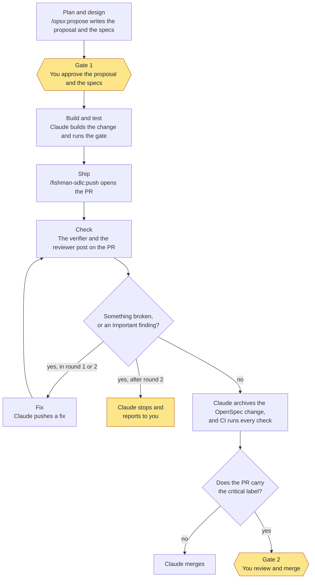

# fishman-sdlc

An AI-native SDLC (software development life cycle) for Claude Code. Claude does the work up to the merge gate. An independent verifier and reviewer check each PR, and you hold the gate. It follows Anthropic's [AI-native SDLC playbook](https://claude.com/resources/articles/the-ai-native-sdlc-playbook): skills advise, hooks enforce, and CI and review verify.

## The loop



The yellow steps are yours. Without OpenSpec, there is no gate 1, and the PR body states the intent.

When to use each part:

- Run `/fishman-sdlc:push` when the change is built and the gate passes. It takes the change from there to the merge.
- Run `/fishman-sdlc:review` on its own to review any PR, for example one that a person wrote. It posts findings and never approves.
- The merge gate needs no command. It acts in every session where the plugin is on, whatever starts the merge.

## The parts

| Part | Kind | What it does |
| --- | --- | --- |
| `/fishman-sdlc:push` | Skill | Opens the PR and runs the verifier and the reviewer on it. It fixes what they find, for up to 2 rounds. Then it merges once every check passes. A critical PR waits for you. |
| `/fishman-sdlc:review` | Skill | Runs the reviewer and posts its findings as inline PR comments. It never approves. |
| `reviewer` | Agent: Opus, high effort | Reviews the diff against the repository's `REVIEW.md` and the change's intent, from a fresh context. It reports and never edits. |
| `verifier` | Agent: Sonnet, medium effort | Runs the gate and exercises each scenario of the change, as its actor. It reports and never fixes. |
| Merge gate | `PreToolUse` hook | Stops Claude from merging a PR that has the `critical` label. |

The short `/push` also works when no other command has that name. Claude Code has a built-in `/review`, so use `/fishman-sdlc:review`.

## Set up a repository

1. Turn on the plugin for the repository:

   ```sh
   claude plugin install fishman-sdlc --marketplace idanfishman/skills --scope project
   ```

   For a team, put the marketplace in the repository's `.claude/settings.json` too, so each clone gets it. Pin `ref` to a release tag, so a new release reaches the repository only when you move the pin:

   ```json
   {
     "extraKnownMarketplaces": {
       "fishman": { "source": { "source": "github", "repo": "idanfishman/skills", "ref": "v1.2.0" } }
     },
     "enabledPlugins": { "fishman-sdlc@fishman": true }
   }
   ```

2. In `CLAUDE.md`, name the gate: one command that runs every check and fails on error. "Done" includes its output.
3. Add a `REVIEW.md`. It names the review passes in order, what counts as Important, the nit cap, and what not to report. Without one, the reviewer runs a bugs pass and a security pass.
4. Create a `critical` label, and have CI add it to each PR that touches a path that needs your review, for example with [actions/labeler](https://github.com/actions/labeler). Without the label, Claude merges each PR whose checks pass.
5. Optional: use [OpenSpec](https://github.com/Fission-AI/OpenSpec) for the intent of each change, with `openspec init --tools claude`. Without it, the PR body states the intent.

## The merge gate

The hook stops Claude from merging a PR that has the `critical` label. It checks `gh pr merge`, the merge and auto-merge routes of `gh api`, and the GitHub MCP merge tools. If it can't read the PR's labels, it blocks. It needs `jq`.

The hook checks only the label. `/fishman-sdlc:push` waits for every check to pass before it merges.

The hook stops a mistake, not an adversary. It reads the command line, so a deliberate bypass can route around it, such as a script or `bash -c`. Where your GitHub plan allows it, add branch protection as the hard boundary.
