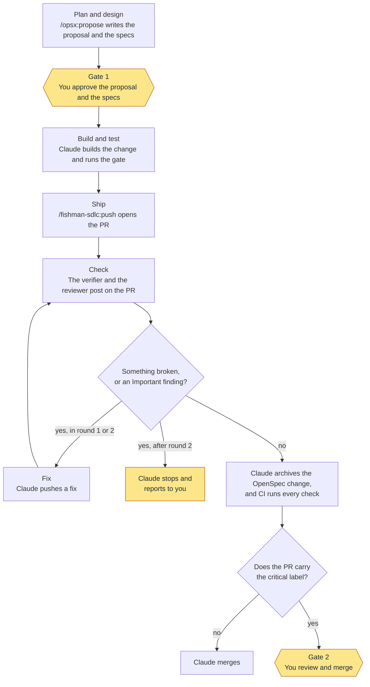
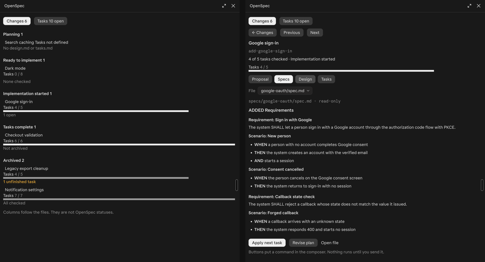

# fishman-sdlc

An AI-native SDLC (software development life cycle) for Claude Code. Claude does the work up to the merge gate. An independent verifier and reviewer check each PR, and you hold the gate. It follows Anthropic's [AI-native SDLC playbook](https://claude.com/resources/articles/the-ai-native-sdlc-playbook): skills advise, hooks enforce, and CI and review verify.

## The loop



The yellow steps are yours. Without OpenSpec, there is no gate 1, and the PR body states the intent.

When to use each part:

- Run `/fishman-sdlc:push` when the change is built and the gate passes. It takes the change from there to the merge.
- Run `/fishman-sdlc:review` on its own to review any PR, for example one that a person wrote. It posts findings and never approves.
- The merge gate needs no command. It acts in every session where the plugin is on, whatever starts the merge.

## The parts

| Part | Kind | What it does |
| --- | --- | --- |
| `/fishman-sdlc:push` | Skill | Opens the PR and runs the verifier and the reviewer on it. It fixes what they find, for up to 2 rounds. Then it merges once every check passes. A critical PR waits for you. |
| `/fishman-sdlc:review` | Skill | Runs the reviewer and posts its findings as inline PR comments. It never approves. |
| `reviewer` | Agent: Opus, high effort | Reviews the diff against the repository's `REVIEW.md` and the change's intent, from a fresh context. It reports and never edits. |
| `verifier` | Agent: Sonnet, medium effort | Runs the gate and exercises each scenario of the change, as its actor. It reports and never fixes. |
| Merge gate | `PreToolUse` hook | Stops Claude from merging a PR that has the `critical` label, or whose checks have not all passed. |
| OpenSpec board | Mod: a pane beside the chat | Shows the repository's OpenSpec Changes, their tasks and their planning documents. It opens by itself in a repository with an `openspec/` folder. `/openspec` opens it again. |

The short `/push` also works when no other command has that name. Claude Code has a built-in `/review`, so use `/fishman-sdlc:review`.

## Set up a repository

1. Turn on the plugin for the repository:

   ```sh
   claude plugin install fishman-sdlc --marketplace idanfishman/skills --scope project
   ```

   For a team, put the marketplace in the repository's `.claude/settings.json` too, so each clone gets it. Pin `ref` to a release tag, so a new release reaches the repository only when you move the pin:

   ```json
   {
     "extraKnownMarketplaces": {
       "fishman": { "source": { "source": "github", "repo": "idanfishman/skills", "ref": "v1.2.0" } }
     },
     "enabledPlugins": { "fishman-sdlc@fishman": true }
   }
   ```

2. In `CLAUDE.md`, name the gate: one command that runs every check and fails on error. "Done" includes its output.
3. Add a `REVIEW.md`. It names the review passes in order, what counts as Important, the nit cap, and what not to report. Without one, the reviewer runs a bugs pass and a security pass.
4. Create a `critical` label, and have CI add it to each PR that touches a path that needs your review, for example with [actions/labeler](https://github.com/actions/labeler). Without the label, Claude merges each PR whose checks pass.
5. Optional: use [OpenSpec](https://github.com/Fission-AI/OpenSpec) for the intent of each change, with `openspec init --tools claude`. Without it, the PR body states the intent.

## The merge gate

The hook stops Claude from merging a PR in two cases:

- The PR has the `critical` label.
- The PR is not ready. Ready means that every check on the PR's head commit finished as success, skipped or neutral. A PR with no checks is not ready.

It checks `gh pr merge`, the merge and auto-merge routes of `gh api`, and the GitHub MCP merge tools. Auto-merge gets the same rule, because without required checks GitHub can merge at once. If the hook can't read the PR's labels or checks, it blocks. It needs `jq`.

The hook stops a mistake, not an adversary. It reads the command line, so a deliberate bypass can route around it, such as a script or `bash -c`. Where your GitHub plan allows it, add branch protection as the hard boundary.

## The OpenSpec board



The board reads `openspec/changes/` and its archive. It is read-only: files stay the source of truth.

- **Changes** puts each Change in one column: Planning, Ready to implement, Implementation started, Tasks complete or Archived. The board sets the column from the files. OpenSpec itself has no such status. A Change is in Planning until its schema's planning documents all exist and its task document has tasks.
- Each Change shows its checked tasks, such as `4 / 5`, and a bar. A Change with no task document shows "Tasks not defined", not 0%. An archived Change keeps its count, and its open tasks show as unfinished. Checked tasks and archiving do not mean that tests passed or that code shipped.
- Search the Changes by title or folder name. Filter them to the ones not archived, the ones with open tasks or the archived ones. Sort them by name, by the most recent edit, by the most tasks done or by the most open tasks.
- **Tasks** lists every task in two groups, Open and Completed. You can filter by Change and hide archived Changes.
- Pick a Change to read its documents. The buttons below a document put an `/opsx:*` command in the prompt box. Nothing runs until you send it.
- The board refreshes at once when Claude edits a file in `openspec/`, and every 5 seconds for edits from other tools. "Claude edited" marks a Change whose files Claude edited in this session.

### Custom schemas

The board follows the schema of each Change, as OpenSpec resolves it: from the Change's `.openspec.yaml`, from `openspec/config.yaml`, or the default `spec-driven`. It asks the `openspec` CLI with `openspec status --change <name> --json`, so a schema in `openspec/schemas/` brings its own documents to the board. The tasks come from the document that the schema's apply step requires.

- The CLI does not read archived Changes. The board reads an archived Change's schema name from its `.openspec.yaml` or `config.yaml`, and matches its files to that schema's documents, as the CLI gave them for an active Change.
- Without the `openspec` CLI on the path, the board says so. It reads `spec-driven` Changes from their files, `skip_specs` included. For another schema, each Markdown file in the Change becomes a document, and the one with checkboxes holds the tasks.

The board is a mod, which uses the early-access Claude Code plugin API. It draws with the elements every surface has, so it works in the terminal and in the desktop app.
